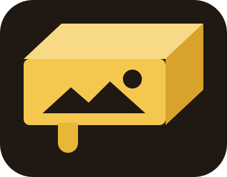
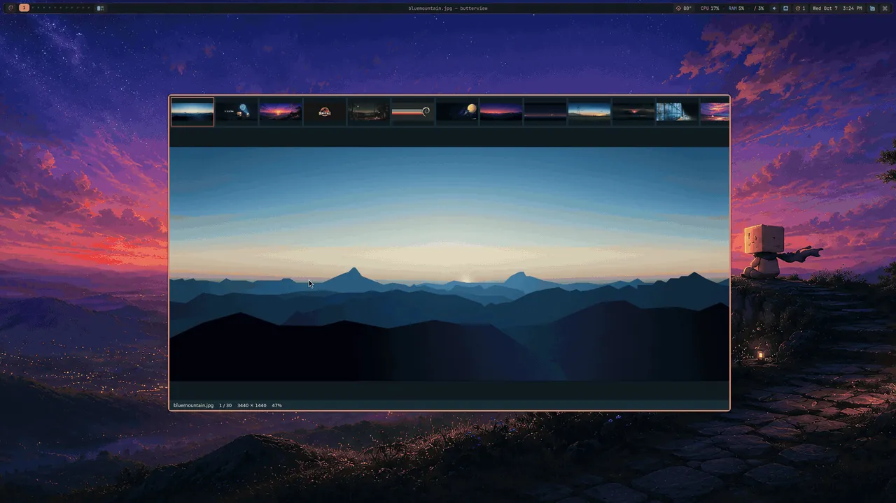

#  butterview

A small, fast image viewer. The image, a strip of the folder's thumbnails
across the top, and a status line. Nothing else.



```
butterview photo.jpg      # that image, with its folder in the strip
butterview ~/Pictures     # a folder
```

## Install

### Debian 13 and Butterbian

From [ButterRepo](https://justaguy.dev/butterrepo):

```bash
sudo apt install butterview
```

The package brings in SDL3, libjpeg-turbo and libdbus; `wl-clipboard`
(or `xclip` on X11) for copying, and `xdg-utils` for opening files from a
file manager.

### NixOS

The repo includes a flake:

[ddubs](https://gitlab.com/dwilliam62/ddubsos) runs butterview from it
and wrote the guide to adding it to your configuration:
[docs/nixos.md](docs/nixos.md).

Anywhere else, see [Build](#build).

| Key | Does |
|---|---|
| Left / Right, Space | previous / next; past the last image, on to the next folder with images (and back before the first) |
| Home / End, PgUp / PgDn | first / last, ten at a time |
| wheel, `+` `-` | zoom, at the pointer |
| drag | pan |
| `f` or F11 | full screen: the picture alone, no strip or status line (Esc leaves it; `t` shows the strip anyway) |
| `0`, `1`, double-click | fit, actual size, switch between them |
| `t` | thumbnail strip on / off; click a thumbnail to jump, wheel over it to scroll |
| `i` | image info: size, dates, and for photos the camera, lens, shutter, aperture, ISO, focal length, location |
| `r` / Shift-`r` | rotate right / left, on screen |
| `x` | crop: a rectangle appears, drag to choose the area, Enter saves, Esc cancels |
| Ctrl-`s` | save what is on screen as a copy |
| `w` | set as wallpaper, with your own command (see [Wallpaper](#wallpaper)) |
| right-click | all of the above as a menu |
| `?` or F1 | the keys, on screen (the status line points to both until one has been opened) |
| Backspace or Enter | folder view: the folders as a tree down the left, this folder's thumbnails in a grid (see [Folders](#folders)); again closes it |
| `s` | sort: by name, newest first, oldest first; remembered |
| `.` or Ctrl-`h` | hidden files and folders shown or left out; remembered |
| `o` | open a folder with the desktop's own dialog |
| `y` or Ctrl-c | copy the image to the clipboard |
| Del | move to the trash, after a yes in a dialog (Enter, `y` or its button; anything else keeps it) |
| `q` or Esc | quit |

## Folders

butterview shows one folder at a time, and three things move it to
another without starting it again:

- **Backspace** opens the folder view, laid out like qimgv's: the
  folders as a tree down the left, from home and from `/`, with the path
  to the current folder already open and how many images each folder
  holds beside it (counting stops at 500); the current folder's
  thumbnails in a grid on the right. In the tree, Up and Down move,
  Right opens a branch or steps into it, Left closes one or steps out,
  Enter shows the folder in the grid. Tab moves to the grid, where the
  arrows move and Enter opens the image. With the mouse: a folder's arrow
  opens its branch, its name shows it, a thumbnail opens the image, the
  wheel scrolls either side. `+` and `-` size the thumbnails. A line
  over the grid names the folder, the count and the sort order.
  Backspace or Esc closes the view.
- **Right past the last image** moves on to the next sibling folder that
  holds images, from its first; Left before the first goes to the
  previous one, from its last. The status line names the folder.

Hidden folders are left out of the tree, except those on the way to the
folder shown; `.` or Ctrl-`h` brings them in, and hidden images with
them.

The sort order, the thumbnail size and the hidden switch are kept in
`$XDG_STATE_HOME/butterview/state` (`~/.local/state/butterview/state`)
between runs.
- **`o`** asks the desktop for its folder dialog through the XDG
  desktop portal, which has the tree, the bookmarks and a search box.
  Where no portal backend answers, the status line says so.
- **A folder or an image dropped on the window** from a file manager is
  opened.

## Rotate and crop never touch the original

Turning a picture changes what is on screen and nothing else. Saving
(Ctrl-s, or Enter in crop) writes a new file beside the original:
`photo-rotated.jpg`, `photo-cropped.jpg`, `photo-edited.jpg` when both,
with `-2`, `-3` if the name is taken. PNGs stay PNG and lossless; JPEGs
are re-encoded at quality 95, and their EXIF block is not carried over.
Other formats are saved as PNG. The viewer then stands on the new file.

## Wallpaper

`w` sets the image as the wallpaper with whatever command you name, and
butterview does not try to guess which one. One line in
`~/.config/butterview/butterview.conf`:

```
wallpaper = awww img
```

The image's path is added on the end, so that runs `awww img
/path/to/photo.jpg`. The command should exit when it is done, since
butterview waits to say whether it worked. For a setter that keeps
running, or one that wants the path somewhere else, put `"$1"` where the
path goes and the line is run as written. Lines starting with `#` are
skipped.

```
# Wayland
wallpaper = awww img
wallpaper = swww img
wallpaper = pkill swaybg; swaybg -m fill -i "$1" &

# X11
wallpaper = feh --bg-fill
wallpaper = xwallpaper --zoom
wallpaper = nitrogen --set-zoom-fill --save

# Desktops
wallpaper = plasma-apply-wallpaperimage
wallpaper = gsettings set org.gnome.desktop.background picture-uri "file://$1"; gsettings set org.gnome.desktop.background picture-uri-dark "file://$1"

# anything else: a script of yours, given the path as $1
wallpaper = ~/.local/bin/set-wallpaper
```

The same list, commented out, comes with the package as
`/usr/share/doc/butterview/butterview.conf.example`
([data/butterview.conf.example](data/butterview.conf.example) here):

```sh
mkdir -p ~/.config/butterview
cp /usr/share/doc/butterview/butterview.conf.example ~/.config/butterview/butterview.conf
```

then take the `#` off the line you use. The file is read when `w` is
pressed, not at start-up.

## Colors

Colors come, first found wins, from `~/.config/butterview/colors.conf`
(`background`, `surface`, `text`, `muted`, `accent`, `border`, as
`key = #rrggbb`); else the GTK4 theme, read from `~/.config/gtk-4.0/gtk.css`
the way libadwaita apps read it (following an `@import`, which is how
KDE and COSMIC hand GTK apps their colors); else the GTK3 theme named in
`~/.config/gtk-3.0/settings.ini`, or in xfconf on Xfce; else the desktop
is asked over the portal whether it is dark or light and which accent it
uses, and a built-in dark or light set is painted with that accent. No
GTK is linked: the theme files are text, the portal is a D-Bus call. They
are re-read when the window gets focus, so a theme change shows the next
time you look at it. `$XDG_CONFIG_HOME` is honored.

## How it is built

Zig, on SDL3 (window, drawing, input), SDL3_image (PNG, JPEG, WebP, GIF,
AVIF, JPEG XL, TIFF, SVG, BMP, QOI, TGA), SDL3_ttf and libdbus (the
desktop portal). No GTK, no Qt. Native Wayland where there is a Wayland
session, X11 otherwise.

- Files are decoded on three worker threads; the window never waits on
  one. Until an image is ready its thumbnail is shown large.
- Animated GIFs play. A small decoder of our own (src/gif.zig) streams
  one frame at a time onto a canvas, a thread keeps three frames ahead,
  and the main loop sleeps until the next is due. A minute of 1080p costs
  a few frames of memory, not all of them, and the first frame is up as
  fast as a still. Rotate, crop and save a copy act on the frame that is
  up. Animated WebPs show their first frame.
- Decoding starts before the window exists. Making a window and its
  renderer takes about as long as decoding a picture, so the two run side
  by side and the image is usually in the first frame.
- JPEGs are decoded at a half, quarter or eighth of their size when that
  is all the screen (or a thumbnail) needs, straight from libjpeg-turbo.
  A strip full of camera photos fills in several times faster for it.
- An image is decoded at the size of the window, with the next and the
  previous one ready behind it. Zoom in past that and every pixel is
  fetched; leave the image and the big copy is dropped.
- JPEGs are turned the way the camera says (EXIF orientation).
- It draws only when something changes: idle, it uses no CPU.

## Not here (yet)

A folder grid, video, RAW and HEIC, resize handles on the crop
rectangle, lossless JPEG rotation, settings, keys you define yourself.

## Build

Zig 0.16, the SDL3 development packages, libjpeg-turbo's and libdbus's:

```bash
sudo apt install libsdl3-dev libsdl3-image-dev libsdl3-ttf-dev libturbojpeg0-dev libdbus-1-dev
zig build -Doptimize=ReleaseSafe
```

`-Dversion=0.1.0` sets what `--version` reports; the package build
passes the release tag. Without installing anything: unpack those
packages and their runtime halves into `.deps/` (`apt-get download`,
`dpkg-deb -x`) and build with `-Dlocal-sdl`. That is how the first
build was made.

`data/` holds the man page, the `.desktop` file and the icon; the Debian
recipe lives in [deb-builders](https://justaguy.dev/drew/deb-builders).

## Staying fast

`./bench.sh <image> [runs]` opens the image in butterview and in every
other viewer installed, several times each, and prints the median time to
a window and the memory afterwards (it needs mango, and windows flash on
screen while it runs). Anything under about 100 ms is below what it can
tell apart; for the finer picture, `BUTTERVIEW_TIMING=1 butterview image`
prints each start-up phase to the terminal, ending with the moment the
image is on screen. On the machine it was written on: about 60 ms for a
3440x1440 screenshot and 70 ms for a 24-megapixel photo.

Checking a change without a screen:

```bash
butterview --shot out.png --size 1280x800 [--goto N] [--zoom 2] path
butterview --shot out.png --keys i path                       # info panel
butterview --shot out.png --keys r,save path                  # rotate, save a copy
butterview --shot out.png --keys sel=0.25:0.25:0.5:0.5,save path   # crop the middle
```

With `BUTTERVIEW_TIMING=1` the status-line messages are printed too,
and which source the colors came from.

## Support

<a href="https://www.buymeacoffee.com/justaguylinux" target="_blank"></a>

## Connect

- [YouTube](https://youtube.com/@justaguylinux) — tutorials and guides
- [Butterforge](https://justaguy.dev/drew) — source code and projects
- [Butter desktops](https://justaguy.dev/butter) — ready-to-use window manager desktops for Debian
- [The Butter Lab](https://lab.justaguylinux.com) — Discourse forum
- [The Churn](https://justaguylinux.chat) — community chat (Fluxer)
- [Wiki](https://justaguy.wiki) — documentation and guides
- [Mastodon](https://fosstodon.org/@justaguylinux) — @justaguylinux@fosstodon.org
- [Butterbian](https://butterbian.org) — a maintained Debian derivative built on Debian stable

## License

GPL-3.0-or-later, see [LICENSE](LICENSE).

---

Made with 🧈 by JustAGuyLinux
